# AiOpicSelfStudy

오픽(OPIc) 영어 말하기 시험을 실제 순서대로 연습하는 Android, iOS 앱이다. 모의고사 15문항을 실제 시험 규칙(질문 글자 없음, 다시 듣기 한 번, 40분)으로 보고, 답변마다 AI 피드백을, 회차마다 예상 등급 범위를 받는다. 앱을 껐다 켜도 멈춘 문항에서 이어진다.

서버는 없다. 사용자가 자기 Gemini API 키를 넣고, 녹음은 기기에만 남는다. Compose Multiplatform 으로 두 플랫폼을 같은 코드로 만든다.

| 키 넣기 | 모의고사 탭 | 연습 탭 | 문항 | 회차 리포트 | 답변 리포트 | 기록 |
|---|---|---|---|---|---|---|
| 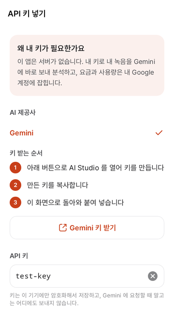 | 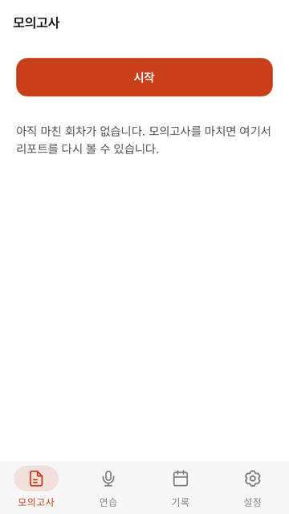 | 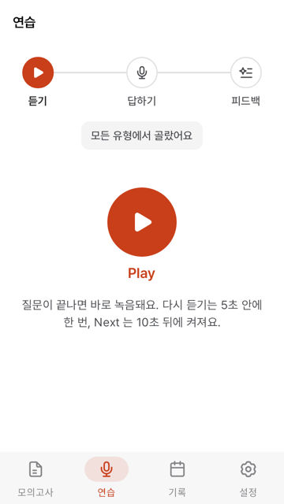 | 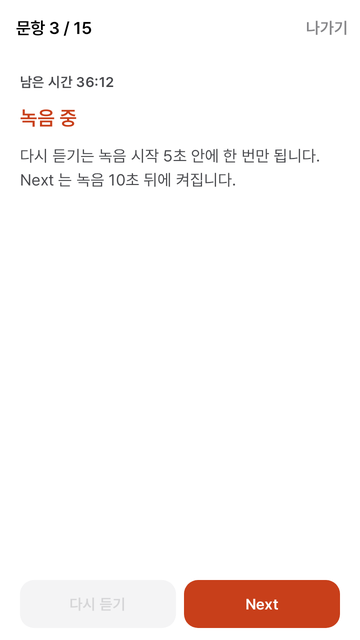 | 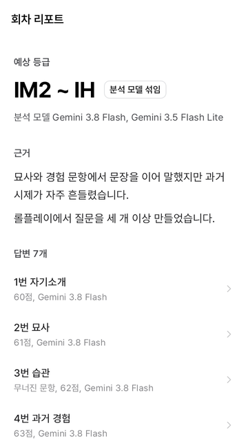 | 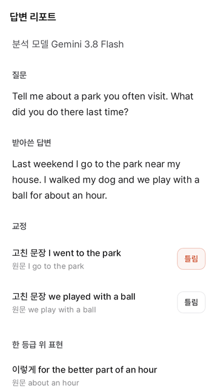 | 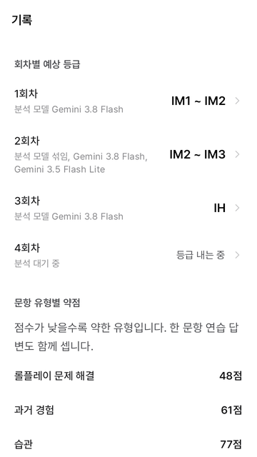 |

## 모의고사 한 회

점검과 1번은 내장 문항으로 바로 내고, 2~7번은 1번 Play 때, 8~15번은 6번 Play 때 재조정 선택지마다 Gemini 에 미리 요청해 고른 것을 쓴다. 40분은 1번 문항에 닿을 때부터 시험 화면에 있는 동안만 흐른다. 답변 분석은 시험이 끝나길 기다리지 않고 Next 마다 뒤에서 보낸다.

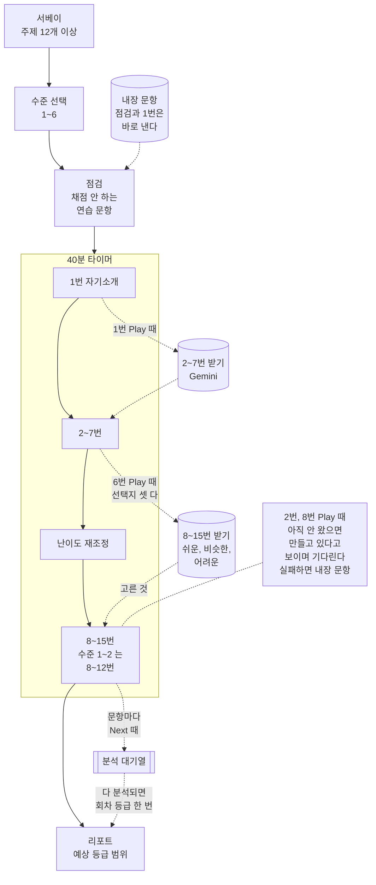

받은 질문은 회차 id 로 저장해서 이어 볼 때 같은 질문이 나온다. 시간이 다 되면 답한 문항만 채점하고 나머지는 "시간 부족"으로 표시한다.

## 앱을 껐다 켜도 이어지는 이유

화면은 상태를 들고 있지 않는다. 일이 생길 때마다 순수 함수가 다음 회차를 계산하고 Room 에 통째로 저장하므로, 앱이 갑자기 죽어도 마지막 저장에서 다시 시작한다.

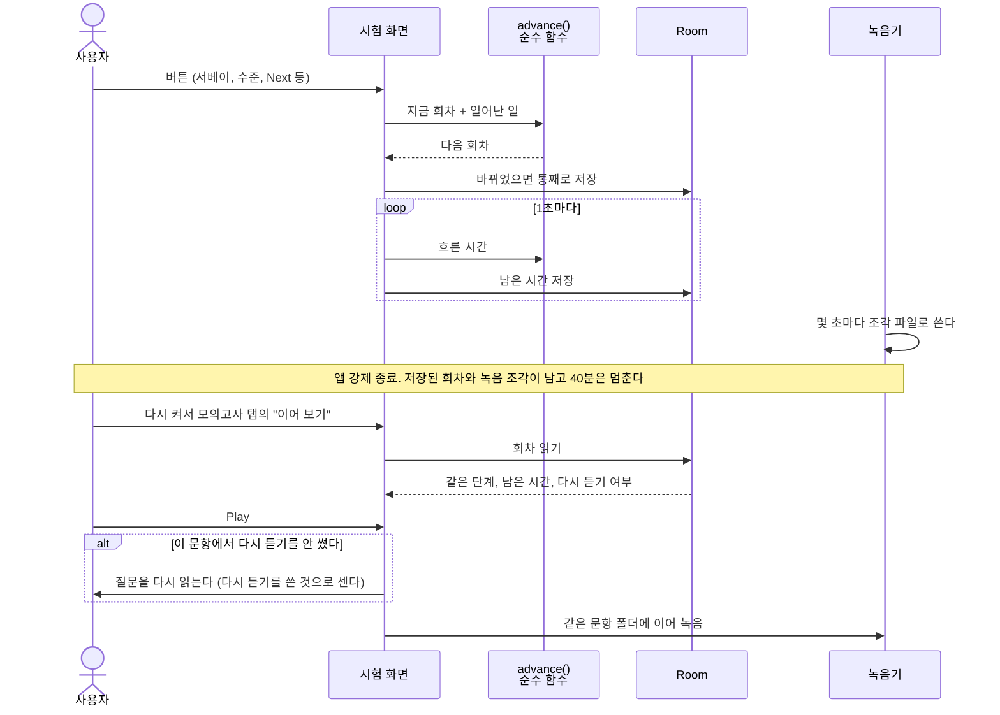

진행 계산이 저장, 화면과 떨어져 있어서 "7번에서 껐다 켜면 재조정 화면부터" 같은 경우를 기기 없이 단위 테스트로 확인한다(ADR 0012, 0013).

## 답변 하나가 분석되는 길

Gemini 응답은 그대로 믿지 않는다. 교정의 원문 구절이 전문에 있는지, 값 범위가 맞는지 앱이 검사하고 통과 못한 항목은 버린다. 분석 작업의 상태는 DB 의 작업 표 한 곳에 있고, 작업은 어떤 경우에도 성공이나 실패로 끝난다. 실패하면 리포트가 이유와 다시 분석하기를 보인다(ADR 0032).

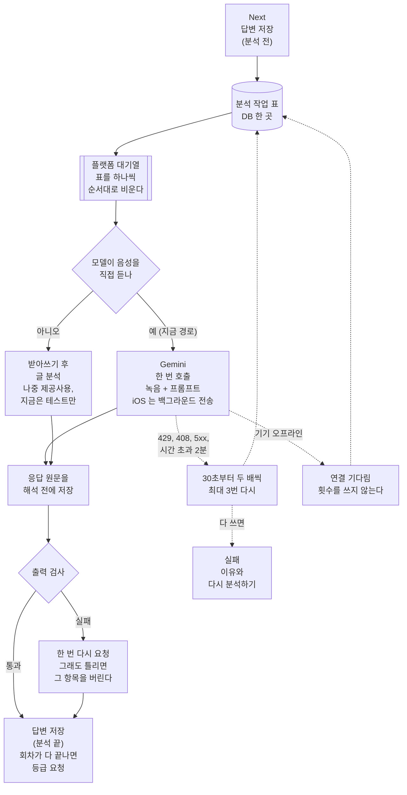

두 단계 경로는 음성을 못 듣는 제공사를 붙일 때 쓰려고 포트만 나눠 둔 것이다(ADR 0019).

## 모듈 구조

다섯 층으로 나누고 의존은 위에서 아래로만 간다. 위 층은 아래 층을 건너뛰어 써도 되지만 `ui` 와 `packs` 는 서로 모르고, `libs` 는 프로젝트 모듈을 하나도 쓰지 않는다. `./gradlew check` 가 이 규칙을 어긴 의존을 찾으면 실패한다.

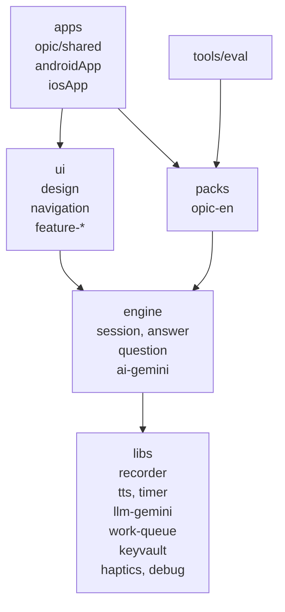

| 층 | 하는 일 |
|---|---|
| apps | 조립만. DI 그래프, 화면 경로 표와 화면 등록(`AppRoute`, `RouteContent`), Android, iOS 앱 틀 |
| ui | 화면. 시험 팩을 모르고 엔진의 타입으로 그린다 |
| packs | 시험 하나의 내용. 서베이, 문항 순서, 체크리스트, 프롬프트, 등급 |
| engine | 시험 진행 계산과 이어 보기, 답변 분석 흐름과 출력 검사, 출제, Gemini 어댑터 |
| libs | 녹음, Gemini 호출, 대기열, 키 보관, 음성 합성, 타이머, 진동, 디버그 도구 |

## 실행

JDK 17, Android SDK, Xcode 가 필요하다.

| 목적 | 명령 |
|---|---|
| 전체 확인 | `./gradlew check` |
| Android 앱 빌드 | `./gradlew :apps:opic:androidApp:assembleDebug` |
| iOS 프레임워크 링크 | `./gradlew :apps:opic:shared:linkDebugFrameworkIosSimulatorArm64` |
| iOS 앱 빌드 | `xcodebuild -project apps/opic/iosApp/iosApp.xcodeproj -scheme iosApp -configuration Debug -destination 'platform=iOS Simulator,name=iPhone 17' -derivedDataPath build/xcode build` |

iOS 앱은 `apps/opic/iosApp` 을 Xcode 로 열어 실행해도 된다.

### 배포용 빌드

키와 비밀번호는 저장소에 넣지 않는다. 업로드 키는 `~/.config/aiopic-release/` 에 두고(폴더 700, 파일 600) 저장소는 서명 정보 파일의 경로만 받는다.

```bash
mkdir -p ~/.config/aiopic-release && chmod 700 ~/.config/aiopic-release && cd ~/.config/aiopic-release
keytool -genkeypair -keystore upload.jks -storetype PKCS12 -alias upload -keyalg RSA -keysize 2048 -validity 10000 -dname "CN=AiOpicSelfStudy"
# 입력한 비밀번호로 서명 정보 파일을 만든다. storeFile 이 상대 경로면 이 파일 옆을 본다.
printf 'storeFile=upload.jks\nstorePassword=<비밀번호>\nkeyAlias=upload\nkeyPassword=<비밀번호>\n' > signing.properties
chmod 600 upload.jks signing.properties
```

경로는 `local.properties` 의 `AIOPIC_RELEASE_SIGNING` 이나 같은 이름의 환경 변수로 넘긴다. 둘 다 없거나 파일이 모자라면 서명 없이 빌드하고 `릴리스 빌드를 서명 없이 만든다: <이유>` 를 찍는다.

| 목적 | 명령 |
|---|---|
| 서명된 AAB | `./gradlew :apps:opic:androidApp:bundleRelease` (결과 `apps/opic/androidApp/build/outputs/bundle/release/androidApp-release.aab`) |
| 서명 확인 | `jarsigner -verify apps/opic/androidApp/build/outputs/bundle/release/androidApp-release.aab` |
| iOS 아카이브 | `xcodebuild -project apps/opic/iosApp/iosApp.xcodeproj -scheme iosApp -configuration Release -destination 'generic/platform=iOS' -archivePath build/release/iosApp.xcarchive -allowProvisioningUpdates archive` |
| App Store 용 ipa | `xcodebuild -exportArchive -archivePath build/release/iosApp.xcarchive -exportOptionsPlist apps/opic/iosApp/ExportOptions.plist -exportPath build/release/ipa -allowProvisioningUpdates` |

iOS 서명 팀은 `Local.xcconfig` 의 `TEAM_ID` 에서 온다. App Store 용 ipa 를 내보내려면 그 팀 계정이 Xcode 설정의 계정에 로그인돼 있어야 배포 프로파일이 자동으로 만들어진다.

App Store Connect 는 같은 빌드 번호를 두 번 받지 않는다. 새 빌드를 올릴 때마다 `apps/opic/iosApp/Configuration/Config.xcconfig` 의 `CURRENT_PROJECT_VERSION` 을 1 올리고(버전 1.0 의 첫 빌드가 1 이다), 사용자에게 보이는 버전이 바뀌면 `MARKETING_VERSION` 도 올린 뒤 커밋한다. 그다음 위 두 명령으로 ipa 를 만들고 TestFlight 로 올린다. 수출 규정 답은 `Info.plist` 의 `ITSAppUsesNonExemptEncryption`(HTTPS 만 써서 `false`)이 대신해서 업로드 뒤에 콘솔에서 따로 답하지 않는다.

```sh
export ASC_API_KEY_PATH=<App Store Connect API 키 JSON 경로>
fastlane ios_build   # build/release/ipa/iosApp.ipa 를 올린다. 처리 완료는 기다리지 않는다
```

### 스토어 문구 올리기

스토어 등록 문구, App Store 심사 메모, 스크린샷은 `fastlane/` 에 있고 [fastlane](https://docs.fastlane.tools) 으로 올린다. 앱 바이너리는 올리지 않고 심사 제출도 하지 않는다. 계정 키는 저장소 밖에 두고 경로만 환경 변수로 넘긴다.

```sh
export PLAY_JSON_KEY_PATH=<Play Console 서비스 계정 JSON 경로>
export ASC_API_KEY_PATH=<App Store Connect API 키 JSON 경로>   # key_id, issuer_id, key 를 담은 fastlane 형식
export REVIEW_GEMINI_KEY=<심사용 Gemini API 키>               # 심사 메모의 {{REVIEW_GEMINI_KEY}} 에 들어간다
fastlane store                                              # 한 스토어만: fastlane play, fastlane app_store
```

| 무엇 | 위치 |
|---|---|
| Play 문구 (이름, 짧은 설명, 전체 설명) | `fastlane/metadata/android/ko-KR/` |
| App Store 문구 (이름, 부제, 홍보 문구, 설명, 키워드, 지원 주소, 개인정보처리방침 주소) | `fastlane/metadata/ios/ko/`. 설명은 Play 전체 설명을 가리킨다 |
| App Store 심사 메모 | `fastlane/metadata/ios/review_information/notes.txt` |
| Play 스크린샷, 아이콘 | `fastlane/metadata/android/ko-KR/images/` (`phoneScreenshots/` 등) |
| App Store 스크린샷 | `fastlane/screenshots/ios/ko/` |

스크린샷은 지어낸 예시 기록(`StoreDemo.kt`)을 넣은 앱을 찍는다. Play 폰 다섯 장(1080x2160)은 `StoreScreenshotTest` 가 `./gradlew recordRoborazziAndroidHostTest` 로 다시 찍고 `check` 가 비교한다. App Store 다섯 장(6.9형, 1320x2868)은 iPhone 17 Pro Max 시뮬레이터에서 XCUITest 로 찍는다.

```sh
xcrun simctl status_bar 'iPhone 17 Pro Max' override --time 9:41 --batteryState charged --batteryLevel 100
TEST_RUNNER_STORE_SCREENSHOTS_DIR="$PWD/fastlane/screenshots/ios/ko" xcodebuild test -project apps/opic/iosApp/iosApp.xcodeproj \
  -scheme iosApp -destination 'platform=iOS Simulator,name=iPhone 17 Pro Max' -only-testing:iosAppUITests/StoreScreenshotsUITests
```

앱 아이콘 원본은 `apps/opic/icon/app-icon.svg` 이고 `python3 apps/opic/icon/make_icon.py` 가 PNG(iOS 기본·다크·틴트, Play 512)를 다시 만든다. 규격과 원본 일치는 `python3 -m unittest scripts/test_store_assets.py` 가 본다.

스크린샷 폴더가 비어 있으면 문구만 올리고 콘솔에 있는 이미지는 건드리지 않는다. 글자 수 제한은 `python3 -m unittest scripts/test_store_metadata.py` 가 키 없이 미리 확인한다. Data safety, 포그라운드 서비스 신고처럼 콘솔에서 직접 넣는 답은 `fastlane/store-declarations.md` 에 있다.

## 문서

| 문서 | 위치 |
|---|---|
| 제품 요구사항 (화면 목록, 수락 기준) | `docs/specs/product.md` |
| 설계 | `docs/specs/design.md` |
| 설계 결정 기록 | `docs/adr/` |
| AI 출력 오류 분석 | `docs/error-analysis.md` |
| 라이브러리 모듈 사용법 | `libs/<모듈>/README.md` |
| 꼭 지킬 것, 명령 | `CLAUDE.md` |
| 노드 진행 절차 | `.claude/skills/node-workflow` |

## AI 사용 범위

이 앱의 코드와 문서는 AI 코딩 에이전트(Claude Code)가 이슈 단위로 구현한다. 개발 그래프(`docs/graph/dev-graph.json`)의 노드 하나가 이슈 하나, 브랜치 하나, PR 하나다. 끝났다는 판정은 에이전트의 말이 아니라 명령의 종료 코드로 한다.

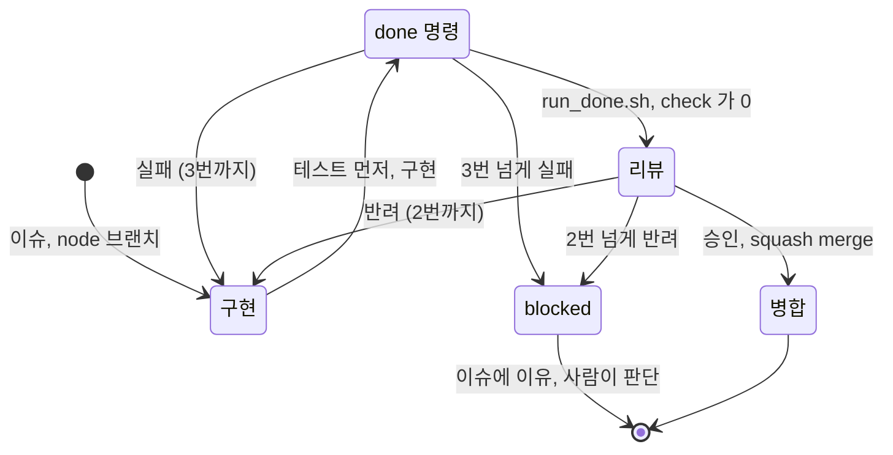

리뷰는 다른 컨텍스트의 리뷰 에이전트가 diff 만 보고 한다.

**사람이 하는 일.**

- 제품 요구사항, 설계, 개발 계획을 승인한다
- 초기 프로젝트를 만들고 Android, iOS 실행을 확인한다
- 에이전트가 깐 작업 환경(규칙 파일, 스킬, 템플릿)을 한 번 확인한다
- 막힌 노드를 판단한다
- 완성 뒤 실기기(Android, iPhone)로 모의고사 한 회를 끝까지 보고, 중간에 앱을 강제 종료해 이어 보기를 확인한다

**AI 출력 검사.** 앱 안의 검사는 위 「답변 하나가 분석되는 길」에 있다. 사용자는 틀린 교정을 표시해 내보낼 수 있다. 모인 표시와 품질 확인 도구(`tools/eval`)의 보고서는 `docs/error-analysis.md` 에서 종류별로 세어 다음 프롬프트 버전에 반영한다.

**규칙 파일과 스킬.**

| 파일 | 내용 |
|---|---|
| `CLAUDE.md` | 꼭 지킬 것, 핵심 명령, 어디를 보나. 50줄 이하로 둔다 |
| `.claude/rules/` | 경로별 규칙(빌드 파일, commonMain, androidMain, iosMain) |
| `.claude/skills/architecture`, `testing`, `adr`, `ui-quality`, `node-workflow` | 이 프로젝트 전용 스킬 |
| `.claude/skills/` 의 나머지 | 외부에서 가져온 스킬. 출처와 라이선스는 `.claude/skills/THIRD_PARTY.md` |
| `.mcp.json` | KMP 라이브러리 검색용 MCP 서버 |

## 라이선스

정하는 중이다. `.claude/skills/` 아래 외부 스킬은 각 원본의 Apache License 2.0 을 따른다.

디자인 시스템: Montage by Wantedlab (MIT). 글꼴 Pretendard 는 SIL OFL 1.1 이다. 전문은 `THIRD_PARTY_LICENSES.md` 에 있다.
