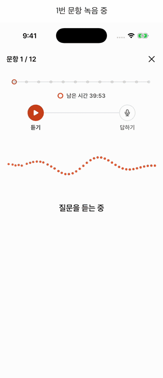
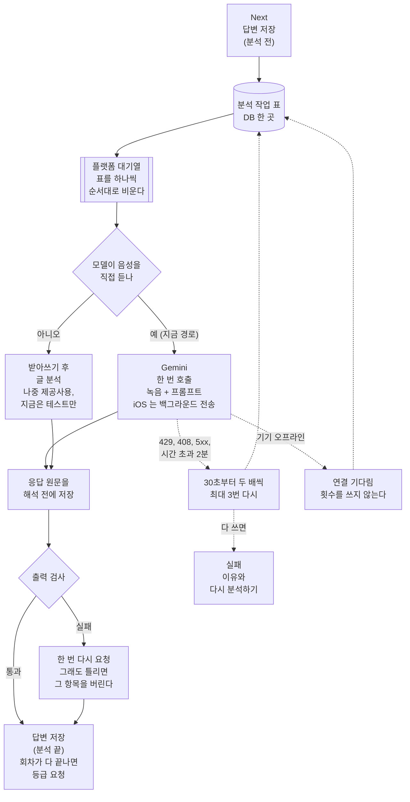
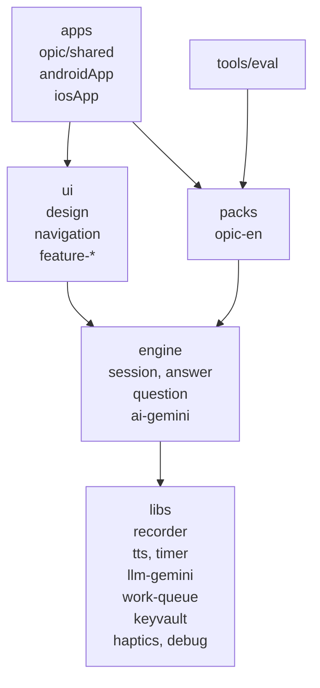
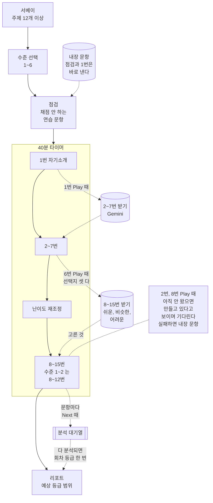
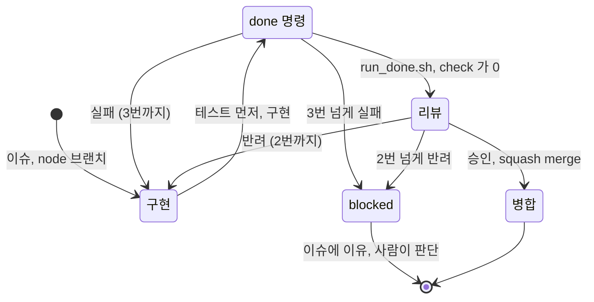

# 말해봄 (malhaebom-opic)

오픽(OPIc) 영어 말하기 시험을 실제 순서와 규칙대로 연습하는 Android, iOS 앱이다. 모의고사 15문항을 질문 글자 없이, 다시 듣기 한 번, 40분으로 보고, 답변마다 AI 피드백을, 회차마다 예상 등급 범위를 받는다. Compose Multiplatform 한 코드로 두 플랫폼을 만들고, 서버 없이 사용자의 Gemini API 키로 분석한다. 녹음은 기기에만 남는다.

- **앱이 죽어도 이어진다.** 시험 진행은 순수 함수가 계산해 단계마다 Room 에 통째로 저장하고, 녹음은 약 5초 조각 파일로 바로 쓴다. 녹음 중 강제 종료해도 잃는 것은 쓰던 조각 하나다
- **LLM 출력을 믿지 않는다.** 교정한 구절이 실제 받아쓰기에 있는지, 점수와 등급이 범위 안인지 앱이 검사해 틀린 항목을 버린다. 같은 대본을 여러 번 채점시켜 등급이 한 단계 후하게 나오는 것을 찾아 프롬프트를 고쳤다
- **화면이 꺼져도, 앱을 내려도 일이 끝난다.** Android 는 마이크 포그라운드 서비스와 WorkManager, iOS 는 백그라운드 오디오와 백그라운드 `URLSession` 업로드를 쓴다. 재시도 규칙은 두 플랫폼이 공통 코드 하나를 쓴다
- **규칙은 빌드가 지킨다.** 모듈 26개의 층 의존, 스크린샷 기준 이미지 237장, `@Test` 1,100여 개를 `./gradlew check` 하나가 검사한다
- **요구사항, 구조 결정, 완료 판정 규칙은 사람이 정했다.** 코딩 에이전트가 이슈 하나씩 구현했고, 작업 노드 55개 중 15개는 판정 명령 실패나 리뷰 반려를 거친 뒤 병합됐다. 자세한 방식은 [개발 방식](#개발-방식)에 있다

| 녹음 중 강제 종료하고 이어 보기 (iOS 시뮬레이터에서 `ExamResumeUITests` 를 돌리며 녹화) |
|---|
|  |

| 모의고사 탭 | 문항 | 회차 리포트 | 답변 리포트 |
|---|---|---|---|
|  |  |  |  |

| 키 넣기 | 연습 탭 | 기록 |
|---|---|---|
|  |  |  |

## LLM 출력을 믿지 않는다

Gemini 는 구조화된 JSON 을 돌려주지만 내용까지 맞다는 보장은 없다. 사용자가 하지 않은 말을 교정하거나, 0~100 밖의 점수를 내거나, 등급 체계에 없는 이름을 쓸 수 있다. 앱은 응답을 화면에 쓰기 전에 검사하고, 하나라도 걸리면 한 번 다시 요청한다([`OutputCheck.kt`](engine/answer/src/commonMain/kotlin/io/github/nosorae/aiopic/engine/answer/check/OutputCheck.kt)).

| 검사 | 다시 받은 응답도 틀리면 |
|---|---|
| 교정, 표현 추천, 내용 교정의 원문 구절이 받아쓰기에 있나 | 그 항목을 버린다 |
| 교정마다 깎은 점수가 0 이상이고 합이 `100 - 점수` 이하인가 | 깎은 점수 표시만 지운다 |
| 점수 0~100, 문장 수와 말 속도가 0 이상인가 | 분석을 실패로 끝낸다 |
| 회차 등급 범위가 등급 체계 안에 있고 아래가 위보다 높지 않은가 | 분석을 실패로 끝낸다 |
| 무너진 문항 번호가 회차 문항 수 안인가 | 그 번호를 버린다 |

분석이 실패로 끝나면 리포트에 이유와 다시 분석하기를 보인다. 받은 응답 원문은 해석하기 전에 DB 에 먼저 저장해서, 해석 코드가 실패하거나 앱이 죽어도 같은 요청을 다시 보내지 않는다(ADR 0032).

앱이 거르지 못하는 오류(맞는 말을 틀렸다고 함, 등급이 후함)는 품질 확인 도구 [`tools/eval`](tools/eval)로 찾는다. 같은 회차를 5번 채점시켜 등급 범위가 몇 번 일치하는지, 일부러 넣은 문법 오류 5개 중 몇 개를 잡는지, 수준이 다른 대본 셋의 등급 순서가 맞는지를 보고서로 남긴다. 지금까지 찾아 고친 것은 둘이다.

1. **등급이 한 단계 후했다.** IM2 수준으로 쓴 대본이 5번씩 두 번 돌린 10번 모두 IM3~IH 를 받았다. 프롬프트가 문장 수준으로 해낸 과거 서술도 Advanced 근거로 셌기 때문이다. Advanced 체크는 문단으로 해낸 것만 세고 등급 아래쪽은 모든 답변에서 유지한 수준으로 정하게 고치자 같은 대본이 5번 모두 IM2~IM3 을 받았다. 오류를 잡은 수(4/5)와 등급 순서는 그대로였다([ADR 0028](docs/adr/0028-회차-등급은-하한으로-정하고-Advanced-체크는-문단으로만-센다.md), [보고서 v1](evals/reports/opic-en-session-grade-v1_opic-en-answer-v2_gemini-3.8-flash.md), [v2](evals/reports/opic-en-session-grade-v2_opic-en-answer-v2_gemini-3.8-flash.md))
2. **무음 녹음에 받아쓰기를 지어냈다.** 아무 말도 하지 않은 녹음에 "Um, I often visit a park near my house..." 받아쓰기와 45점이 나왔다. 프롬프트에 들리지 않는 말은 쓰지 말라고 적었고, 앱은 녹음 내내 음량이 기준 아래면 보내지 않으며 받아쓰기가 비어 있으면 점수를 버리고 무음으로 친다

사례와 프롬프트 버전별 결과는 [`docs/error-analysis.md`](docs/error-analysis.md) 에 쌓는다. 사용자가 앱에서 틀린 교정을 표시해 내보내면 같은 표에 더한다.

## 앱을 껐다 켜도 이어지는 이유

화면은 상태를 들고 있지 않는다. 일이 생길 때마다 순수 함수가 다음 회차를 계산하고 Room 에 통째로 저장하므로, 앱이 갑자기 죽어도 마지막 저장에서 다시 시작한다.

진행 계산이 저장, 화면과 떨어져 있어서 "7번에서 껐다 켜면 재조정 화면부터" 같은 경우를 기기 없이 단위 테스트로 확인한다([ADR 0012](docs/adr/0012-시험-진행-상태는-순수-함수와-Room.md)). 녹음은 문항 폴더에 조각으로 쌓고, 다시 켜면 같은 폴더에 다음 번호로 이어 쓴다. 보내기 직전에 조각을 한 파일로 합치면서 이어 녹음한 지점을 함께 넘겨, 모델이 그 틈을 말 멈춤으로 세지 않게 한다([ADR 0013](docs/adr/0013-녹음-조각-저장과-이어-녹음.md)).

실제로 프로세스를 죽이는 테스트도 있다. Android 계측 테스트 `ExamE2eTest` 는 2번 문항 녹음 중에 프로세스를 끝내고 다음 단계에서 PID 가 바뀐 것을 확인한 뒤 이어 보기부터 리포트까지 간다. iOS 는 `ExamResumeUITests` 가 녹음 중 앱을 끝내고 같은 문항으로 돌아오는지 본다(위 영상).

## Android, iOS 에서 한 일

화면과 로직은 공통 코드지만, 시험 중에 화면이 꺼지거나 앱을 내리는 일은 플랫폼마다 다르게 막아야 한다.

| 문제 | Android | iOS |
|---|---|---|
| 화면이 꺼져도 녹음이 이어져야 한다 | 마이크 포그라운드 서비스(`foregroundServiceType="microphone"`). 앱이 뒤에 있어 서비스를 못 띄우면 크래시 대신 마이크를 못 쓴다고 알린다 | `UIBackgroundModes` 의 `audio` 와 `AVAudioEngine` 입력 |
| 앱이 죽으면 녹음을 잃는다 | `MediaRecorder` 의 `setMaxFileSize` 와 `setNextOutputFile` 로 녹음기를 멈추지 않고, 5초 분량 크기(64kbps 기준 40KB)에 닿을 때마다 파일만 바꾼다. 합칠 때는 `MediaExtractor`, `MediaMuxer` | `AVAudioEngine` 은 계속 돌리고 `AVAudioFile` 만 5초마다 닫고 새로 연다 |
| 전화가 오면 녹음이 끊긴다 | 오디오 포커스를 잃으면 조각을 닫고, 돌아오면 새 조각으로 이어 녹음한다 | `AVAudioSession` 인터럽션 알림으로 같은 일을 한다 |
| 40분 타이머가 기기 잠자기에 영향받으면 안 된다 | `SystemClock.elapsedRealtimeNanos` | `CLOCK_MONOTONIC` |
| 분석 요청이 앱을 내려도 끝나야 한다 | WorkManager 고유 작업 사슬 하나가 연결 조건으로 작업 표를 비운다. 분석 중에는 진행 알림을 포그라운드 작업으로 띄운다 | `beginBackgroundTask` 로 시간을 받고, 녹음을 실은 요청은 백그라운드 `URLSession` 업로드로 보낸다. 앱이 멈춰도 시스템이 전송을 끝낸다. 뒤로 가면 `BGProcessingTask` 를 예약한다 |
| 로그인 페이지에 막힌 Wi-Fi 를 온라인으로 보면 재시도를 헛쓴다 | `NET_CAPABILITY_VALIDATED` 인 네트워크만 온라인으로 본다 | `nw_path_monitor` 의 연결 여부만 본다. 로그인 페이지에 막힌 Wi-Fi 는 온라인으로 보고, 연결 실패를 다시 보낼 실패로 센다 |

녹음기를 조각마다 멈췄다 다시 열지 않는 것은 실측 때문이다. iPhone 에서 조각마다 녹음기를 새로 열면 조각 사이에 약 0.07초가 빠져 8분 녹음 중 1.7% 를 잃었다([설계 문서](docs/specs/design.md)의 미리 확인 표). 두 플랫폼 모두 녹음기는 한 번 열고 쓰는 파일만 바꾼다.

분석 작업의 상태는 플랫폼 대기열이 아니라 Room 의 작업 표 한 곳에 있다. 플랫폼 대기열은 "표를 비워라"는 신호만 주고, 재시도 횟수와 대기 시간은 공통 코드가 정한다. 그래서 WorkManager 의 백오프와 iOS 백그라운드 시간 차이가 결과에 섞이지 않고, 재시도 규칙을 테스트 시계로 확인한다. 이 구조로 바꾸기 전에는 대기열과 결과가 따로 있어서, 앱이 보내는 중에 죽으면 리포트가 끝없이 "분석 대기 중"에 머물렀다([ADR 0032](docs/adr/0032-분석-작업-상태는-DB-한-곳에-두고-플랫폼-대기열은-비우기만-한다.md)).

## 답변 하나가 분석되는 길

분석 포트는 받아쓰기와 글 분석 두 단계로 나눠 두었다. Gemini 는 음성을 직접 들어 한 번 호출로 끝내고, 음성을 받지 않는 제공사를 붙이면 받아쓴 뒤 글만 보낸다. 엔진 코드에는 제공사 이름이 없고, 두 단계 경로는 음성을 못 듣는 가짜 제공사로 테스트한다([ADR 0019](docs/adr/0019-AI-분석은-받아쓰기와-글-분석-두-단계-포트.md)).

## 모듈 구조

다섯 층으로 나누고 의존은 위에서 아래로만 간다. 위 층은 아래 층을 건너뛰어 써도 되지만 `ui` 와 `packs` 는 서로 모르고, `libs` 는 프로젝트 모듈을 하나도 쓰지 않는다. 층마다 허용하는 층을 [`LayerRules.kt`](build-logic/src/main/kotlin/io/github/nosorae/aiopic/buildlogic/LayerRules.kt) 표 하나에 두고, `./gradlew check` 가 이 규칙을 어긴 의존을 찾으면 실패한다([ADR 0002](docs/adr/0002-모듈-다섯-층과-의존-검사.md)).

| 층 | 하는 일 |
|---|---|
| apps | 조립만. DI 그래프, 화면 경로 표와 화면 등록(`AppRoute`, `RouteContent`), Android, iOS 앱 틀 |
| ui | 화면. 시험 팩을 모르고 엔진의 타입으로 그린다 |
| packs | 시험 하나의 내용. 서베이, 문항 순서, 체크리스트, 프롬프트, 등급 |
| engine | 시험 진행 계산과 이어 보기, 답변 분석 흐름과 출력 검사, 출제, Gemini 어댑터 |
| libs | 녹음, Gemini 호출, 대기열, 키 보관, 음성 합성, 타이머, 진동, 디버그 도구 |

시험 내용은 `packs/opic-en` 하나에만 있다. 다른 언어 오픽이나 다른 말하기 시험은 팩과 앱 모듈만 새로 만들면 된다.

## 모의고사 한 회

점검과 1번은 내장 문항으로 바로 내고, 2~7번은 1번 Play 때, 8~15번은 6번 Play 때 재조정 선택지마다 Gemini 에 미리 요청해 고른 것을 쓴다. 출제를 기다리느라 첫 Play 가 10초 넘게 걸리던 것을 이렇게 나눠 없앴다([ADR 0030](docs/adr/0030-출제는-세-몫으로-나눠-미리-받는다.md)). 40분은 1번 문항에 닿을 때부터 시험 화면에 있는 동안만 흐른다. 답변 분석은 시험이 끝나길 기다리지 않고 Next 마다 뒤에서 보낸다.

받은 질문은 회차 id 로 저장해서 이어 볼 때 같은 질문이 나온다. 시간이 다 되면 답한 문항만 채점하고 나머지는 "시간 부족"으로 표시한다.

## 개발 방식

코드와 문서는 코딩 에이전트(Claude Code)가 이슈 단위로 구현했다. 사람은 무엇을 만들지와 핵심 설계를 정하고, 에이전트가 정한 대로 끝까지 일하게 만드는 규칙과 검사를 만들었다.

**사람이 정한 것.** 요구사항([`docs/specs/product.md`](docs/specs/product.md))과 설계([`docs/specs/design.md`](docs/specs/design.md))를 쓰고 승인했다. 그중 구조를 정한 결정은 이렇다.

- 서버 없이 사용자의 API 키로 분석한다. 녹음이 남의 서버에 쌓이지 않고 운영 비용이 없다([ADR 0001](docs/adr/0001-서버-없이-사용자-API-키.md))
- 시험 진행은 순수 함수 하나와 Room 통째 저장, 녹음은 조각 저장과 이어 녹음. 시험 한 회가 40분이라 중간에 앱이 죽는 일을 기본 경우로 봤다([ADR 0012](docs/adr/0012-시험-진행-상태는-순수-함수와-Room.md), [0013](docs/adr/0013-녹음-조각-저장과-이어-녹음.md))
- 분석 모델은 사용자가 고르고, 음성을 못 듣는 제공사도 붙일 수 있게 분석 포트를 두 단계로 나눈다([ADR 0019](docs/adr/0019-AI-분석은-받아쓰기와-글-분석-두-단계-포트.md))
- 모듈 다섯 층과 빌드가 하는 의존 검사([ADR 0002](docs/adr/0002-모듈-다섯-층과-의존-검사.md)). 사람과 에이전트 모두 문서 규칙은 어기므로 빌드가 막게 했다
- DI 는 컴파일 타임에 바인딩을 검사하는 Metro([ADR 0004](docs/adr/0004-DI-는-Metro.md)), 일회성 이벤트는 상태 필드와 처리 완료 Intent([ADR 0006](docs/adr/0006-일회성-이벤트는-상태-필드와-처리-완료-Intent.md))

**에이전트에게 맡긴 방식.** 할 일은 개발 그래프([`docs/graph/dev-graph.json`](docs/graph/dev-graph.json))의 노드 55개로 쪼갰다. 노드 하나가 이슈 하나, 브랜치 하나, PR 하나다. 끝났는지를 판정하는 명령은 개발 계획을 짤 때 노드마다 함께 정했고, 사람이 계획을 승인했다. 그래서 에이전트가 "다 됐다"고 말해도 명령이 0으로 끝나지 않으면 끝난 게 아니다. 실기기 확인처럼 명령으로 판정할 수 없는 노드 5개는 사람이 확인한다([ADR 0020](docs/adr/0020-그래프-done-은-실행-명령과-안쪽-루프.md)).

- 리뷰는 구현한 에이전트가 아니라 다른 컨텍스트의 리뷰 에이전트가 diff 만 보고 한다. 지울 수 있는 코드부터 찾는다
- done 명령이 3번 실패하거나 리뷰가 2번 반려되면 스크립트가 노드를 막고 사람을 부른다. 횟수는 그래프에 남는다. 노드 55개 중 판정 명령이 실패한 노드가 12개(16번), 리뷰가 반려한 노드가 8개(10번)였고, 상한을 넘어 막힌 노드는 없었다
- `./gradlew check` 는 층 검사, ktlint, Android Lint, 테스트, 스크린샷 비교를 한 번에 돈다. pre-push 훅이 브랜치 push 마다 돌리고, CI 는 PR 마다 돌리면서 추가된 줄에 키나 개인 경로가 있는지도 본다
- 에이전트가 읽는 규칙은 50줄 이하의 [`CLAUDE.md`](CLAUDE.md), 경로별 규칙 `.claude/rules/`(빌드 파일, commonMain, androidMain, iosMain), 필요할 때 읽는 스킬(`.claude/skills/architecture`, `testing`, `adr`, `ui-quality`, `node-workflow`)이다. 결정을 새로 하면 ADR 로 남긴다

이 방식으로도 에이전트는 틀린다. 아래 셋은 처음 구현이 테스트를 모두 통과한 뒤에 나왔다.

- 등급이 한 단계 후했다. 품질 확인 도구 보고서에서 찾았다([ADR 0028](docs/adr/0028-회차-등급은-하한으로-정하고-Advanced-체크는-문단으로만-센다.md))
- 무음 녹음에 받아쓰기를 지어냈다. 에뮬레이터에서 아무 말 없이 답해 보다가 찾았다(#241)
- 녹음을 끝내고 결과를 기다리는 화면의 로딩이 끝나지 않았다. 실기기에서 쓰다가 찾았다(#203). 원인은 대기열과 결과가 따로 있던 구조라서 작업 상태를 DB 한 곳으로 옮겼다([ADR 0032](docs/adr/0032-분석-작업-상태는-DB-한-곳에-두고-플랫폼-대기열은-비우기만-한다.md))

나올 때마다 원인을 ADR 로 남기고 그 경우를 테스트로 더했다.

## 실행

JDK 17, Android SDK, Xcode 가 필요하다.

| 목적 | 명령 |
|---|---|
| 전체 확인 | `./gradlew check` |
| Android 앱 빌드 | `./gradlew :apps:opic:androidApp:assembleDebug` |
| iOS 프레임워크 링크 | `./gradlew :apps:opic:shared:linkDebugFrameworkIosSimulatorArm64` |
| iOS 앱 빌드 | `xcodebuild -project apps/opic/iosApp/iosApp.xcodeproj -scheme iosApp -configuration Debug -destination 'platform=iOS Simulator,name=iPhone 17' -derivedDataPath build/xcode build` |

iOS 앱은 `apps/opic/iosApp` 을 Xcode 로 열어 실행해도 된다. 서명된 빌드와 스토어 업로드는 [`docs/release.md`](docs/release.md) 에 있다.

## 문서

| 문서 | 위치 |
|---|---|
| 제품 요구사항 (화면 목록, 수락 기준) | [`docs/specs/product.md`](docs/specs/product.md) |
| 설계 | [`docs/specs/design.md`](docs/specs/design.md) |
| 설계 결정 기록 (35개) | [`docs/adr/`](docs/adr) |
| AI 출력 오류 분석 | [`docs/error-analysis.md`](docs/error-analysis.md) |
| 배포 | [`docs/release.md`](docs/release.md) |
| 라이브러리 모듈 사용법 | `libs/<모듈>/README.md` |
| 꼭 지킬 것, 명령 | [`CLAUDE.md`](CLAUDE.md) |
| 노드 진행 절차 | [`.claude/skills/node-workflow`](.claude/skills/node-workflow/SKILL.md) |

## 라이선스

Copyright (c) 2026 nosorae. All rights reserved. 코드는 읽고 참고하라고 공개한다. 복제, 수정, 배포는 허락하지 않는다. 자세한 내용은 [`LICENSE`](LICENSE) 에 있다.

`.claude/skills/` 아래 외부 스킬은 각 원본의 라이선스(Apache License 2.0, MIT)를 따르고 출처는 [`.claude/skills/THIRD_PARTY.md`](.claude/skills/THIRD_PARTY.md) 에 있다. 디자인 시스템은 Montage by Wantedlab(MIT), 글꼴 Pretendard 는 SIL OFL 1.1 이다. 전문은 [`THIRD_PARTY_LICENSES.md`](THIRD_PARTY_LICENSES.md) 에 있다.
