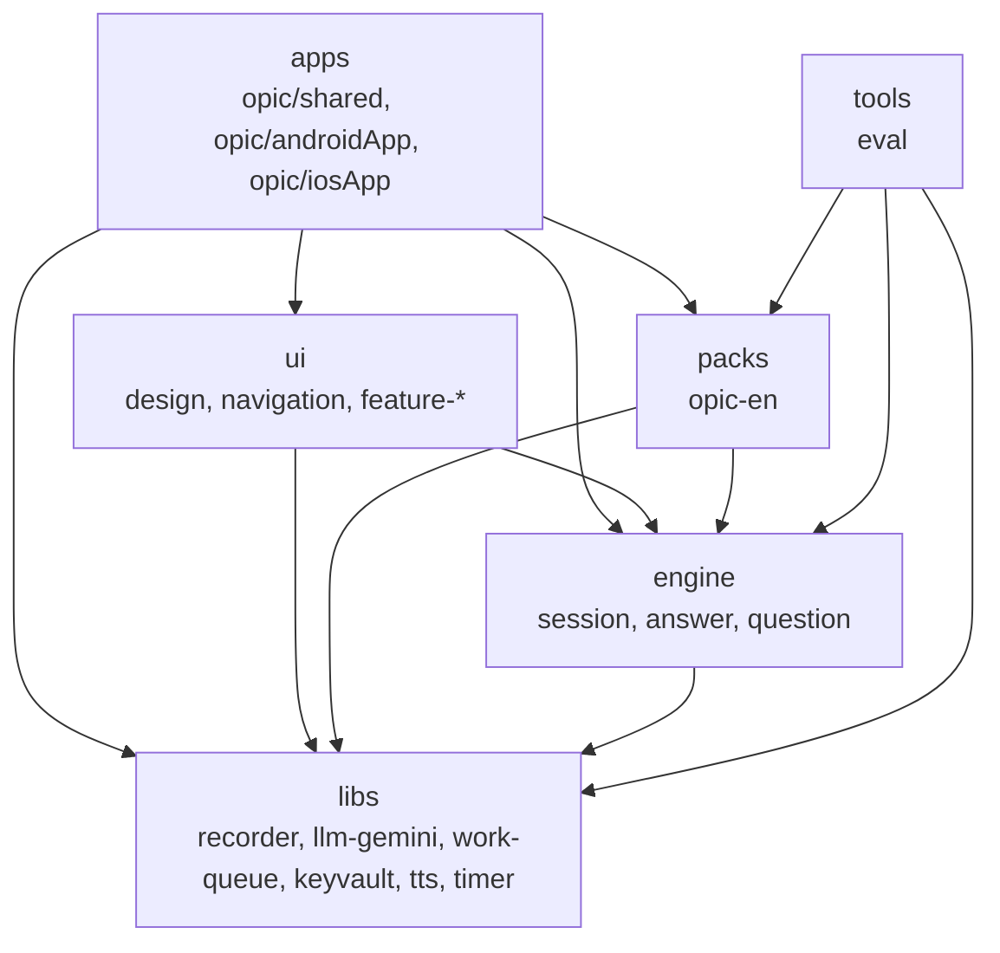

# AiOpicSelfStudy

오픽(OPIc) 영어 말하기 시험을 실제 순서대로 연습하는 Android, iOS 앱이다. 모의시험 15문항을 실제 시험 규칙(질문 글자 없음, 다시 듣기 한 번, 40분)으로 보고, 답변마다 AI 피드백을, 회차마다 예상 등급 범위를 받는다. 앱을 껐다 켜도 멈춘 문항에서 이어진다.

서버는 없다. 사용자가 자기 Gemini API 키를 넣고, 녹음은 기기에만 남는다. Compose Multiplatform 으로 두 플랫폼을 같은 코드로 만든다.

## 모듈 구조

다섯 층으로 나누고, 의존은 위에서 아래로만 간다. `./gradlew check` 가 층 규칙을 어긴 의존을 찾으면 실패한다.

| 층 | 하는 일 |
|---|---|
| apps | 조립만. DI 그래프, Android, iOS 진입점 |
| ui | 화면. 시험 팩을 모르고 엔진의 타입으로 그린다 |
| packs | 시험 하나의 내용. 서베이, 문항 순서, 체크리스트, 프롬프트, 등급 |
| engine | 시험 진행 계산과 이어 보기, 답변 분석 흐름과 출력 검사, 출제 |
| libs | 녹음, Gemini 호출, 대기열, 키 보관, 음성 합성, 타이머. 프로젝트 모듈 의존 0개 |

## 실행

JDK 17, Android SDK, Xcode 가 필요하다.

| 목적 | 명령 |
|---|---|
| 전체 확인 | `./gradlew check` |
| Android 앱 빌드 | `./gradlew :apps:opic:androidApp:assembleDebug` |
| iOS 프레임워크 링크 | `./gradlew :apps:opic:shared:linkDebugFrameworkIosSimulatorArm64` |
| iOS 앱 빌드 | `xcodebuild -project apps/opic/iosApp/iosApp.xcodeproj -scheme iosApp -configuration Debug -destination 'platform=iOS Simulator,name=iPhone 17' -derivedDataPath build/xcode build` |

iOS 앱은 `apps/opic/iosApp` 을 Xcode 로 열어 실행해도 된다.

## 문서

| 문서 | 위치 |
|---|---|
| 제품 요구사항 (화면 목록, F1~F8 수락 기준) | `docs/specs/product.md` |
| 설계 | `docs/specs/design.md` |
| 설계 결정 기록 | `docs/adr/` |
| 작업 규칙, 명령 | `CLAUDE.md` |

## AI 사용 범위

이 앱의 코드와 문서는 AI 코딩 에이전트(Claude Code)가 이슈 단위로 구현한다.

**에이전트가 하는 일.** 개발 그래프의 노드 하나가 GitHub 이슈 하나다. 에이전트는 이슈 하나를 맡아 `node/<노드id>` 브랜치에서 테스트를 먼저 쓰고 구현한다. 노드의 완료 조건은 실행 명령이고 `scripts/graph/run_done.sh <노드id>` 와 `./gradlew check` 가 0 으로 끝나야 끝난 것으로 보고, 리뷰를 거쳐 PR 을 병합한다. done 명령이 실패하면 세 번까지, 리뷰가 반려하면 두 번까지 다시 구현하고, 넘으면 노드를 blocked 로 두고 이슈에 이유를 남긴다.

**사람이 하는 일.**

- 제품 요구사항, 설계, 개발 계획을 승인한다
- 초기 프로젝트를 만들고 Android, iOS 실행을 확인한다
- 에이전트가 깐 작업 환경(규칙 파일, 스킬, CI, 템플릿)을 한 번 확인한다
- 막힌 노드를 판단한다
- 완성 뒤 실기기(Android, iPhone)로 모의시험 한 회를 끝까지 보고, 중간에 앱을 강제 종료해 이어 보기를 확인한다

**AI 출력 검사.** 앱 안에서도 Gemini 응답을 그대로 믿지 않는다. 교정의 원문 구절이 전문에 있는지, 값 범위와 문항 수가 맞는지 앱 코드가 확인하고, 통과하지 못한 항목은 버린다. 사용자는 틀린 교정을 표시해 내보낼 수 있다.

**규칙 파일과 스킬.**

| 파일 | 내용 |
|---|---|
| `CLAUDE.md` | 모듈 구조, 명령, 작업 규칙, Claude Code 메모. 에이전트와 사람이 같이 따른다 |
| `.claude/rules/` | 소스셋별 규칙(commonMain, androidMain, iosMain) |
| `.claude/skills/architecture`, `testing`, `adr`, `ui-quality` | 이 프로젝트 전용 스킬 |
| `.claude/skills/` 의 나머지 | 외부에서 가져온 스킬. 출처와 라이선스는 `.claude/skills/THIRD_PARTY.md` |
| `.mcp.json` | KMP 라이브러리 검색용 MCP 서버 |

## 라이선스

정하는 중이다. `.claude/skills/` 아래 외부 스킬은 각 원본의 Apache License 2.0 을 따른다.
