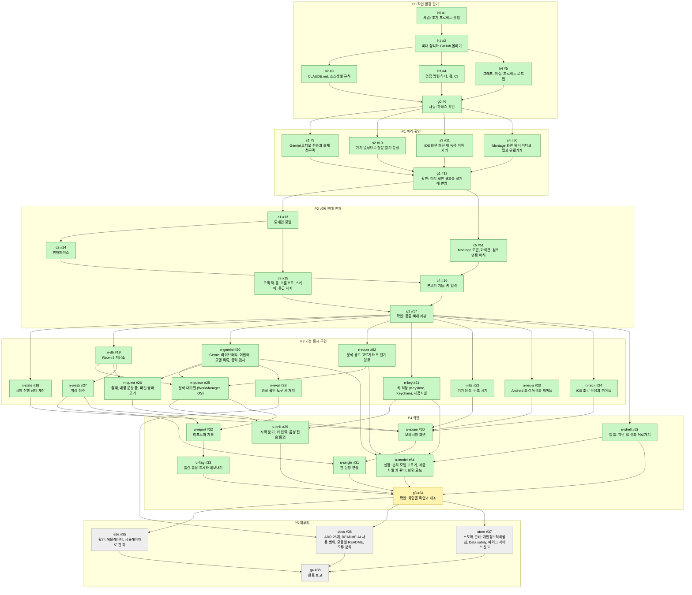
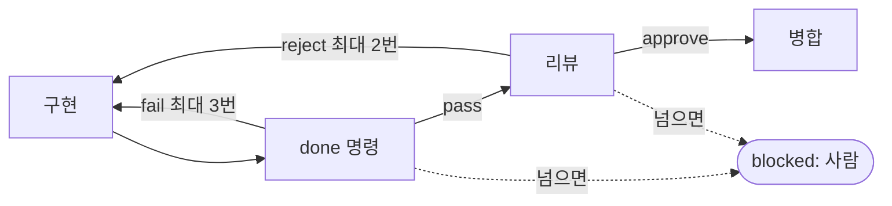

# 개발 그래프

`scripts/graph/render.py` 가 `dev-graph.json` 에서 만든다. 손으로 고치지 않는다.

노드 41개: todo 4, doing 1, done 36, blocked 0. 색은 회색 todo, 노랑 doing, 초록 done, 빨강 blocked 이다.

## 노드 안쪽 루프

모든 노드가 같은 반복을 돈다. `dev-graph.json` 의 `loop` 가 원본이고 노드의 `loop` 가 횟수 상한을 덮어쓴다. done 이 `human` 인 노드는 사람이 확인한다.

