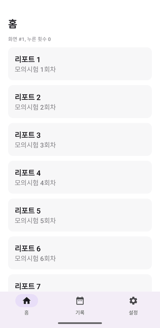
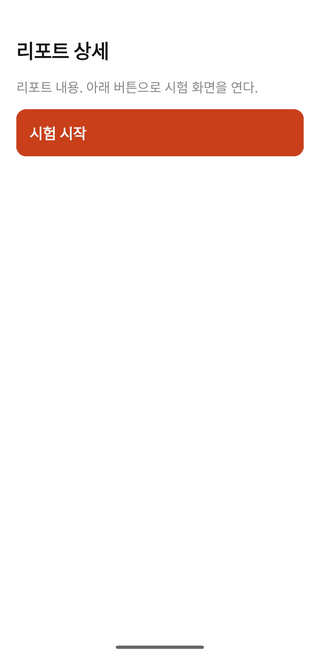
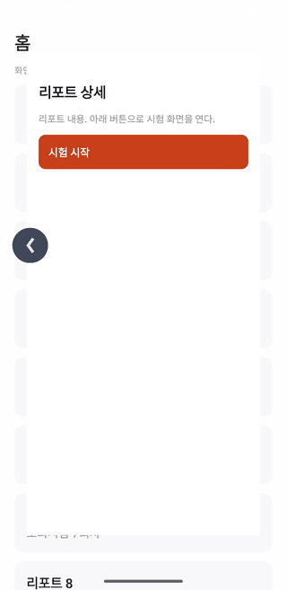
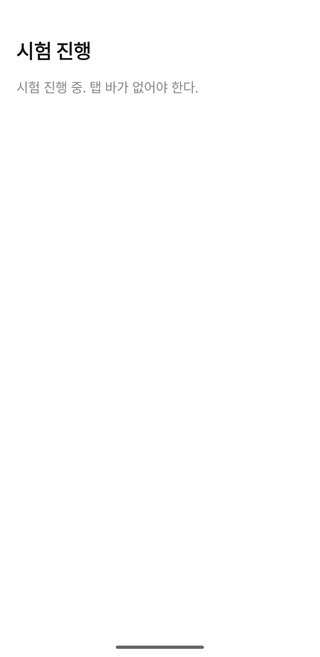
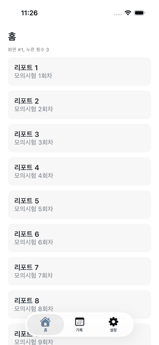
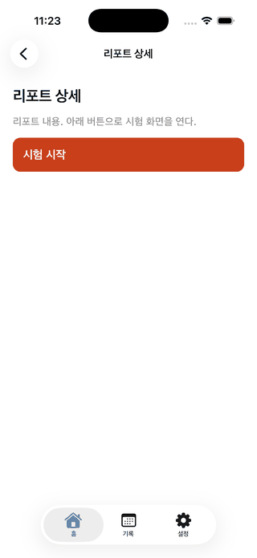
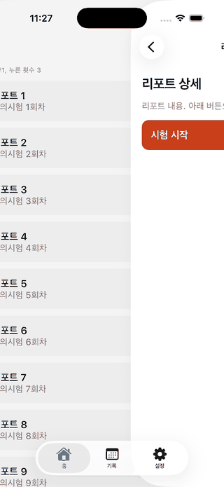
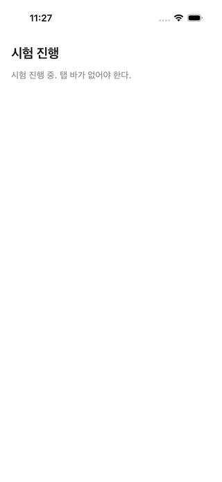

# native-chrome (s4)

Montage 토큰으로 그린 Compose 화면 위에 하단 탭과 뒤로가기를 플랫폼 네이티브로 얹으면 관리 비용이 어떤지 확인한다. 판정은 `result.json` 에 있다. 기준 넷 모두 아니오라서 ADR 0018 대로 네이티브를 유지한다.

## 무엇을 만들었나

| 폴더 | 내용 |
|---|---|
| `shared/` | KMP 모듈. Montage v4.0.0(MIT) 라이트 색 5개와 글자 스타일 4개, 목록과 상세 화면 두 개, 앱 틀의 화면 경로 표(`Chrome.kt`) |
| `android/` | 앱 모듈. Material 3 Expressive `ShortNavigationBar`, Navigation 3 `NavDisplay`, 예측 뒤로가기 |
| `iosApp/` | xcodegen 명세. SwiftUI `TabView` 안 탭마다 `NavigationStack`, 목적지마다 `ComposeUIViewController`. 실제 터치로 도는 UI 테스트 하나 |
| `screenshots/` | 판정 근거 스크린샷 |

색과 글자 스타일은 Montage 값을 숫자로만 옮겼다. 글꼴, 아이콘, 로고, 워드마크는 가져오지 않았다. 전체 이식은 노드 `c5` 가 한다.

## 왜 빌드에 넣지 않았나

`settings.gradle.kts` 에 넣으면 이 실험 코드도 `./gradlew check` 의 층 검사, ktlint, Lint, 스크린샷 비교 대상이 된다. 제품에 쓰지 않을 코드를 계속 맞춰 줄 이유가 없어서 실험하는 동안만 넣고 뺐다. 코드는 판정 근거의 줄 번호를 가리키려고 남긴다.

## 다시 돌리는 법

1. `settings.gradle.kts` 의 `include(...)` 에 `":spikes:native-chrome:shared"`, `":spikes:native-chrome:android"` 를 더한다
2. Android: `./gradlew :spikes:native-chrome:android:installDebug` 후 실행. 시작 화면은 `adb shell am start -n io.github.nosorae.aiopic.spike.nativechrome/io.github.nosorae.aiopic.spikes.nativechrome.android.MainActivity --es start ReportDetail` 처럼 `start` 로 고른다(`ReportDetail`, `Exam`)
3. iOS: `cd spikes/native-chrome/iosApp && xcodegen generate` 후 저장소 루트에서

```
xcodebuild test -project spikes/native-chrome/iosApp/NativeChromeSpike.xcodeproj -scheme NativeChromeSpike -destination 'platform=iOS Simulator,name=iPhone 17'
```

## 확인한 것

- Android 는 최상위 탭 화면에서만 탭 바가 보이고, 상세와 시험 화면에서 숨는다. 상세에서 왼쪽 가장자리를 끌면 예측 뒤로가기 애니메이션이 나온다
- iOS 는 상세 화면에도 Liquid Glass 탭 바가 남고, 시험 화면에서 숨는다. 왼쪽 가장자리 스와이프로 목록에 돌아간다. 탭을 옮겼다 돌아와도 Compose 화면의 상태가 남는다
- iOS 탭 숨기기는 `.toolbar(보일 때 .automatic, 숨길 때 .hidden, for: .tabBar)` 로 쓴다. 보일 때 `.visible` 을 주면 첫 화면 설정이 이겨 시험 화면에서도 탭이 남는다
- Android 예측 뒤로가기 도중에는 뒤에 보이는 최상위 화면의 탭 바가 아직 안 나오고, 손을 놓은 뒤 나타난다. 앱 틀이 탭 표시를 백스택 맨 위 화면으로만 정해서다. 실제 앱에서 거슬리면 앱 틀 한 곳만 고치면 된다

## 스크린샷

| Android 목록 | Android 상세 | Android 뒤로 끄는 중 | Android 시험 |
|---|---|---|---|
|  |  |  |  |

| iOS 탭 전환 뒤 목록 | iOS 상세 | iOS 가장자리 스와이프 중 | iOS 시험 |
|---|---|---|---|
|  |  |  |  |
